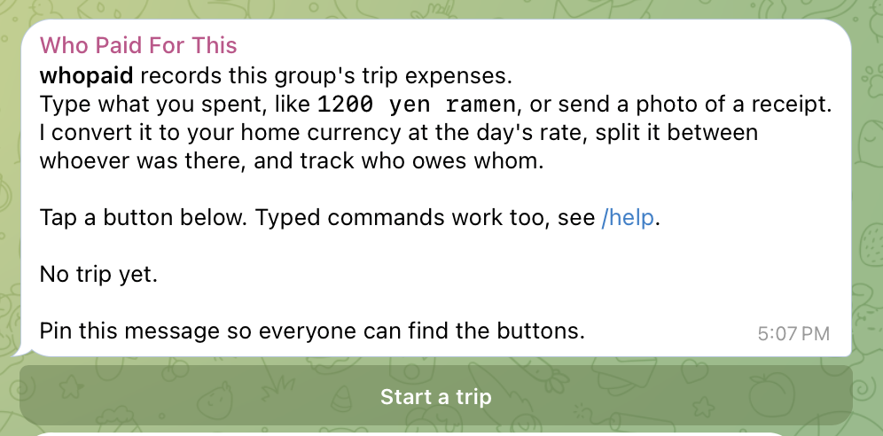
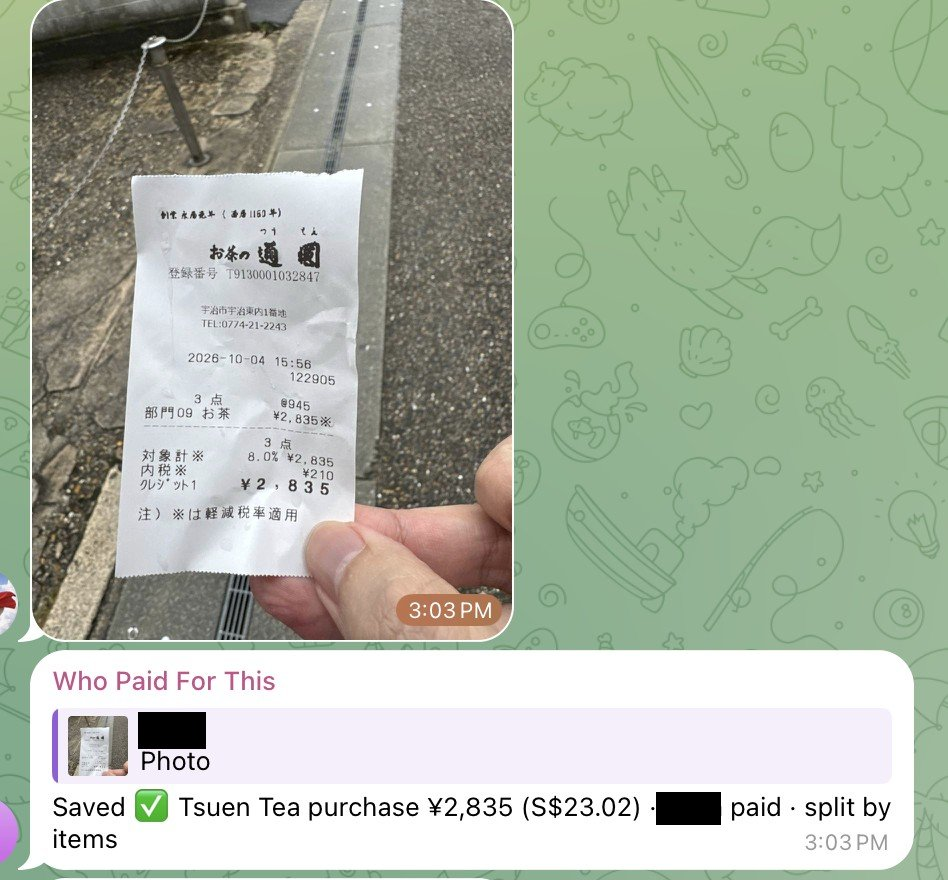
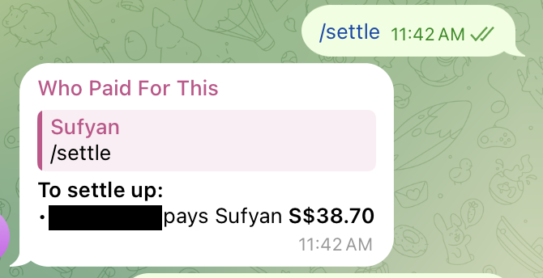
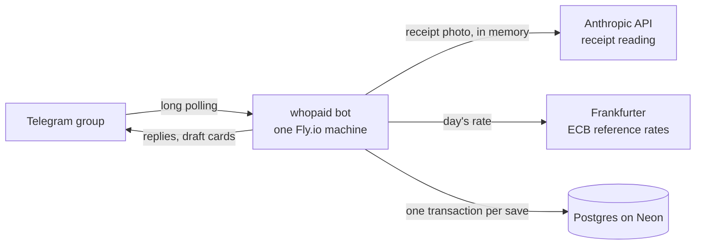

# whopaid

A Telegram bot that keeps a trip's group expenses in Postgres (Neon). Type `1200 yen ramen`
or send a receipt photo; it converts to your home currency at that day's rate, splits it between
whoever was there (equally, by custom amounts, or item by item off the receipt), and tells you
who owes whom. One Telegram group has one open trip at a time. It runs on one small Fly.io
machine.

<p align="center">
  
</p>
<p align="center">
  
  &nbsp;&nbsp;
  
</p>

Project status and sign-offs: `STATUS.md`. Settled design decisions: `docs/spec/pinned-decisions.md`.

## Architecture



- **Bot** (`app/bot`): Telegram handlers, the draft cards and their buttons.
- **Services** (`app/services`): pure logic — the text parser, name resolution, splitting,
  settlement, receipt reading and total selection, exchange rates — plus `PostgresLedgerStore`.
- **Drafts** live in memory for 30 minutes while people press buttons; only a confirmed expense
  is written to the database, in one transaction.

## Data model

Postgres tables, created by `app/db/migrations/001_initial.sql`:

| Table | One row is | Key columns |
|---|---|---|
| `trips` | one trip of one chat | currencies, timezone, who started it, `closed_at` (one open trip per chat) |
| `trip_users` | one person in a trip | Telegram user ID, name, joined |
| `expenses` | one confirmed or cancelled expense | payer, description, original amount, trip and home amounts, rate, split method, status |
| `splits` | one person's share of one expense | share in trip and home currency |
| `line_items` | one line from a receipt | amount, who had it, `claimed` / `everyone` / `proportional` for an item-by-item split (`unassigned` otherwise), kind |
| `exchange_rates` | one cached rate | currency pair, requested date, rate date, rate |

Amounts are stored in minor units (yen as whole numbers, SGD in cents). Every expense's shares
add up exactly to its amount in both currencies. Expenses are never deleted: `/undo` marks them
`cancelled`. `/export` writes them to an `.xlsx` with sheets for expenses, shares, line items, people and balances.

## Splitting model

Every expense has one **payer** (who handed over the money) and one or more **participants**
(who owe a share). The draft card asks who should share it:

- **Just me** — the sender is the only participant.
- **Everyone** — every trip user who has run `/join`, counted at the moment you tap it.
- **Choose people** — one toggle per joined user (you start selected), then **Next**.

Before that, if nobody was tagged and the message doesn't say `paid by`, the bot asks **Who
paid?** with a button per person (you as **Me**).

With more than one participant the card asks how to split:

- **Split equally** — everyone gets `total // n`; the leftover minor units (yen, cents) go one each
  to participants in Telegram user ID order, skipping the payer while anyone else is left.
- **Type amounts instead** — reply to the card with one line per person, e.g. `Amir 2000`. The card shows
  each person's amount and `Remaining: ¥0 ✅` once they add up exactly; **Confirm** only
  appears then. Anyone you don't mention gets nothing and is dropped.
  Forgot to reply? The same lines sent on their own still fill your open card, as long as every
  line names someone on it. If the card expired (30 minutes idle, or the bot was updated), a
  reply to it says so instead of starting a new expense.

The preview lists every share in both currencies, payer marked 💳, with **Confirm**, **Edit**
(back to choosing people, amount kept) and **Cancel**. Only the person who sent the expense can
press its buttons; anyone else gets "Only <name> can edit this".

You can skip the buttons in the message itself:

- `6000 yen dinner split everyone` (or `split all`)
- `6000 yen dinner split between me Amir and John` (also `among`, `with`)
- `3000 yen lunch paid by Amir` — the payer doesn't have to be a participant
- `3000 yen lunch @amir` — tagging someone means they paid (in a receipt caption too)

Names match a joined user's username, first name or full name, ignoring case; `me` is you. If a
name matches nobody or more than one person, the card asks "Who did you mean by 'Jon'?" with
buttons — it never guesses.

Shares are computed in the currency the expense was entered in, then converted to the other
currency share by share and reconciled with the largest-remainder method, so shares always add
up exactly to the expense amount in both currencies.

### Itemised receipts

On a receipt with 1 to 40 items, the split card asks "Who had what?" and offers, one per row,
**🍽 Go item by item ▶**, **Split equally** and **Type amounts instead**.

Item by item shows one item at a time, in the order printed on the receipt:

```
Who had this?  (2 of 4)
Egg Sando Set (2/2) · ฿333.73
[✓ Irina] [✓ Sufyan] [hn]
[Everyone]
[🚫 Not on this bill]
[◀ Back]  [Next ▶]
```

Tap the names of whoever had it, then **Next ▶**. Two or more names means they shared it,
split equally. **Everyone** gives the item to everyone and moves on. **Next ▶** with nobody
ticked says "Pick who had this first". A line with a quantity of 2 to 10 gets one screen per
unit, `(1/2)` and `(2/2)`, so one set can go to one person and the other be shared. Only the
person who sent the receipt can press these buttons.

After the last item the check card shows each person's total with `items ¥a + tax ¥b` under
it, and the tax, service, discount and unlisted lines it spread. **Fix an item** lists every
item with the initials of who had it; pick one, answer it again, and you are back on the check
card. **Edit** goes back to choosing people; picks for people still in are kept.

Tax, service charge and discounts are spread in proportion to what each person's items cost
(largest-remainder method, so the yen add up exactly); someone with no items pays none of them
and is saved with a zero share. The `Line Items` tab records who had each item and whether it
was `claimed`, went to `everyone`, or was spread `proportional`ly.

If the lines don't add up to the receipt total, the difference becomes one **Unlisted /
rounding** line, shared like tax. A total you picked or typed gets a prompt first showing the
difference, with **Continue with <total>** and **Cancel**; a total the bot picked on its own is
at most 5 off the lines and needs no prompt.

**Group orders where everyone paid their own part.** Some delivery receipts list the whole
order but also say what you paid ("you paid", "your share"). The bot puts that figure first on
the total buttons. Pick it, then **Continue**; the prompt suggests marking the rest. Go item by
item and tap **🚫 Not on this bill** on each dish someone else paid for. Fees and discounts are
scaled to the dishes you kept, and whatever is still left over (the app's own rounding of its
split) goes on the **Unlisted / rounding** line. The check card lists what was left out;
**Fix an item** shows those dishes with `—` and can bring one back by ticking a name. At least one
dish must stay. **Split equally** and **Type amounts instead** ignore these marks.

## BotFather setup

1. In Telegram, open a chat with `@BotFather` and create a bot with `/newbot` (or pick yours with
   `/mybots`).
2. **API Token**: copy it into `TELEGRAM_BOT_TOKEN`. Treat it like a password.
3. **Bot Settings → Group Privacy → Turn off** (see Privacy mode below).
4. Optional: **Edit Bot → Edit Commands**, and paste:
   ```
   help - What this bot does
   join - Join this trip
   settrip - Start a trip for this group
   recent - Last 5 expenses
   today - Today's expenses
   summary - Group totals
   mine - What I paid and owe
   balances - Everyone's balances
   settle - Who pays whom
   undo - Cancel my last expense
   ```

## Adding to a group

Use a dedicated group for the trip's expenses. Add the bot to it like any member, after turning
privacy mode off. It posts a welcome message with a **Start a trip** button and pins it (or asks
you to). Starting a trip asks for the trip currency, home currency and timezone with buttons,
then everyone taps **I'm in too**; **Everyone's in** closes joining and posts the full button
menu. Typed commands (`/settrip`, `/join`, `/help`) do the same things.

## Privacy mode

The bot reads ordinary messages like `1200 ramen`, so Telegram's privacy mode must be **off**
(BotFather → Bot Settings → Group Privacy → Turn off). If the bot was already in the group when
you changed it, remove it and add it again, or it keeps the old setting. It only reacts to
messages with an amount of at most 12 words, commands, receipt photos, replies to its own cards,
and button presses; everything else is ignored.

Receipt photos are downloaded, resized, and sent to the Anthropic API entirely in memory —
they are never written to disk and never logged (not the image bytes, not the base64, not the
LLM request). Once the read finishes, the bot keeps only the Telegram file ID (so "Try again"
can re-download the same photo) and the structured facts it extracted: merchant, total, date,
and line items. Those facts, not the photo, are what end up in the database.

## Neon (Postgres)

Postgres on Neon is the only store (ADR 0003) — there is no Google Sheet, no service account,
no per-trip setup beyond `/settrip` itself.

1. Create a [Neon](https://neon.tech) project in region **AWS Singapore**.
2. Copy the pooled connection string (it includes `sslmode=require`).
3. Put it in your local `.env` as `DATABASE_URL=...`.
4. `fly secrets set DATABASE_URL=...` for `whopaid-bot` in production.
5. Install Docker Desktop or Colima so the store tests can run locally (`docker compose up -d`).

At startup the bot creates a small connection pool and applies any pending migrations
(`app/db/migrations/`); a missing or unreachable `DATABASE_URL` fails fast with a one-line error.

### Starting a trip

In the Telegram group for the trip, run `/settrip`. It asks three quick questions with buttons:
the trip currency (what you're paying in — THB, MYR, JPY, CNY shown first, then **Other…** for
any other 3-letter code), the home currency (what you'll settle up in), and the timezone
(defaults to the one that matches the trip currency, e.g. Japan → Asia/Tokyo). Confirm, and the
trip is saved. A group that already has an open trip gets a new one — the old trip is closed,
never deleted, and stays exportable (export lands in a later sprint).

Once started, everyone in the group should send `/join` (or `/start`) so the bot knows who's
splitting expenses.

## What is stored and how to delete it

The database holds: Telegram user IDs, usernames and display names; expense descriptions,
amounts, categories and timestamps; and the trip's own settings (currencies, timezone). Receipt
images are never stored — only the facts an LLM read off them (merchant, total, line items).
`/deletetrip`, run by whoever started the trip, hard-deletes that chat's trips and every row
under them in one transaction; this is irreversible.

## LLM setup

Receipt reading uses the Anthropic API (`ANTHROPIC_API_KEY`, see Environment variables). In the [Anthropic Console](https://console.anthropic.com/), set a monthly spend
limit on the API key so a bug or a flood of photos can't run up a surprise bill — a few dollars
is plenty for a trip's worth of receipts. Each receipt read costs a fraction of a cent to a
couple of cents; you can watch usage accrue under Usage in the Console.

### Receipts

Send a photo of a receipt in a bound group and the bot reads it with an LLM: merchant,
total, date, and the individual line items. Just photograph the whole receipt, including the
totals section at the bottom — the clearer and flatter the photo, the better the read.

If the receipt shows more than one number that could be the total (for example a
tax-included and a tax-excluded total both printed), the bot asks "Which is the final
total?" with buttons for each candidate, plus **Other amount** to type it yourself. If the
total you pick doesn't match the line items added up, it shows the difference with **Continue
with <total>** and **Cancel**; the difference is shared like tax. The total you chose is always
what gets saved.

If the bot can't read a receipt at all (too blurry, not a receipt), it says "Couldn't read
that receipt" with two buttons: **Try again** (re-reads the same photo) and **Enter amount
manually** (reply to that message with just the amount, e.g. `2400`).

A caption on the photo overrides the description the LLM guessed — a receipt sent with the
caption `dinner` saves as "Dinner" rather than whatever the LLM extracted.

Line items are stored in the `line_items` table. Item amounts there are always in the
trip currency; for a receipt paid in the home currency they are converted at that expense's
rate. A caption can also carry `split everyone`, `split between me Amir` or `paid by Amir`,
exactly as in a text expense.

## FX provider

Rates come from [Frankfurter](https://frankfurter.dev) (no key), which publishes the European
Central Bank's daily reference rates. Each expense uses the rate for its own date; on weekends
and holidays, or before the day's rate is out (around 16:00 CET), that is the previous business
day's rate, and the card shows which date it used. Rates are cached in the `Exchange Rates` tab.
If the provider can't be reached, the card says so with a **Retry** button and nothing is saved.
An expense can be in the trip currency or the home currency; anything else is refused.

## Environment variables

Set in `.env` locally (copy `.env.example`; never commit `.env`) and as Fly secrets in production.

| Variable | What |
|---|---|
| `TELEGRAM_BOT_TOKEN` | the bot's token from BotFather |
| `DATABASE_URL` | Neon's pooled Postgres connection string (`sslmode=require`) |
| `ANTHROPIC_API_KEY` | API key from console.anthropic.com |
| `LOG_LEVEL` | optional: `DEBUG`, `INFO` (default), `WARNING`, `ERROR` |

`BOT_VERSION` is baked into the image at deploy time (the short git SHA) and shown by `/help`.

## Local testing

```
uv sync
uv run pytest
uv run ruff check .
uvx pre-commit run --all-files
uv run python -m app
```

The tests need no network or keys: they use an in-memory store, fixed exchange rates and a fake
receipt reader, and simulate several Telegram users pressing buttons. Run the bot locally only
while the deployed one is stopped (see Deployment). `docs/manual-test-checklist.md` is the full
manual regression run against a test group.

## Deployment

The bot runs on Fly.io as one machine, long-polling Telegram. **Stop the local bot before
deploying, and never run both at once** — two pollers on the same bot token make Telegram
return 409 and both go deaf.

1. Install flyctl (`brew install flyctl`, or see [fly.io/docs/flyctl/install](https://fly.io/docs/flyctl/install/))
   and run `fly auth login`.
2. `fly launch --no-deploy --copy-config --name whopaid-bot --region sin`. Answer **No** to
   Postgres, Redis and any other add-on.
   If Fly says the name is taken, accept the name it suggests (or use `whopaid-bot-<4 chars>`);
   `--copy-config` writes it into `fly.toml`, and every later command uses that name.
3. `./scripts/set-fly-secrets.sh` copies the secrets from `.env` to Fly. It prints the variable
   names it set, never the values.
4. `./scripts/deploy.sh`. Wait for "deployed successfully".
5. `fly status`. Exactly one machine, state `started`. If `fly machine list` shows two, run
   `fly scale count 1`.
6. `fly logs`. You see `whopaid started`.
7. Stop any local copy of the bot, then send `/help` and `500 coffee` in your test group and
   confirm it; the database gets the row.

### Updating

Merging to `main` deploys automatically: `.github/workflows/deploy.yml` runs ruff and the
tests, then the same deploy as `./scripts/deploy.sh` (remote build, `--ha=false`). Watch it in
the repo's **Actions** tab; **Run workflow** there redeploys `main` by hand. Confirm `/help` in
the test group shows the new version. `./scripts/deploy.sh` from a laptop still works too.

The workflow needs one repo secret, `FLY_API_TOKEN`: a deploy token for this app only. Create
it in the Fly dashboard (the app → **Tokens** → create a deploy token, or `fly tokens create
deploy` on a laptop) and save it in GitHub under Settings → Secrets and variables → Actions →
New repository secret. If the token leaks, revoke it in the same Fly page and make a new one.

### Log level

`LOG_LEVEL` isn't set by `./scripts/set-fly-secrets.sh` (it isn't a secret). If you ever need
it, set it by hand: `fly secrets set LOG_LEVEL=DEBUG`.

### Why no port

The bot uses long polling: it calls out to Telegram, nothing listens for incoming connections.
There is no `[http_service]` in `fly.toml` and no Fly health check configured. The `whopaid
started` line in `fly logs` is the health signal — if it's there, the bot is up.

## Example usage

In the trip group (names here are examples):

```
Ada:     1200 yen ramen
bot:     🧾 Ramen · ¥1,200 (S$9.72)
         2 Oct 2026
         Who paid?
         [Me] [Amir] [Cancel]
Ada:     (taps Me)
bot:     🧾 Ramen · ¥1,200 (S$9.72)
         Ada paid · 2 Oct 2026
         Rate 1 JPY = 0.00810 SGD (1 Oct)
         Who should share this?
         [Just me] [Everyone] [Choose people] [Cancel]
Ada:     (taps Everyone, then Split equally)
bot:     Check before saving
         🧾 Ramen · ¥1,200 (S$9.72)
         Ada paid
         Each person's share:
         • Ada ¥600 (S$4.86)
         • Amir ¥600 (S$4.86)
         [Confirm] [Edit] [Cancel]
Ada:     (taps Confirm)
bot:     Saved ✅ Ramen ¥1,200 (S$9.72) · Ada paid · split 2 ways

Amir:    /balances
bot:     Who owes what (SGD)
         • Ada is owed S$4.86
            (paid S$9.72, share S$4.86)
         • Amir owes S$4.86
            (paid S$0.00, share S$4.86)
         Settle up with /settle
Amir:    /settle
bot:     To settle up:
         • Amir pays Ada S$4.86
Amir:    /mine
bot:     Amir
         You paid S$0.00 for the group.
         Your share of everything is S$4.86.
         ➡️ You owe S$4.86 overall.
         Recent:
         • 2 Oct · Ramen ¥1,200 (S$9.72)
            Ada paid · your share S$4.86
```

Screenshots are at the top of this README; the tester's name is blacked out.

## Settlement logic

Balances and settling up are in the home currency only, each expense converted at its own
day's rate (see `docs/adr/0001`). For each person: **paid** is the total of expenses they paid,
**share** the total of their shares, and **net** = paid − share (positive means they're owed).
Cancelled expenses don't count.

- `/balances` — one bullet per person with any activity, most owed first: "Ada is owed
  S$31.20" / "Amir owes S$31.20" / "Cy is all square", with their paid and share under it.
- `/mine` — in plain sentences, what you paid for the group, your share of everything, and
  whether you owe or are owed overall; then your last 3 expenses with your share of each.
- `/settle` — who pays whom, one bullet per transfer, e.g. `• Amir pays Ada S$31.20`, or
  "All square 🎉".

`/settle` is greedy: it repeatedly has the person who owes most pay the person owed most, as
much as one of them needs. That takes at most one transfer fewer than the number of people with a
balance. It is near-minimal, not guaranteed minimal.

## Limitations

- **Single machine only.** Exactly one bot process may poll Telegram; two (e.g. a laptop and Fly)
  make both stop receiving messages.
- **Drafts are lost on restart.** A card that was mid-way when the bot restarted says "This
  expense expired, please send it again".
- **Albums are separate drafts.** Several photos sent together each become their own expense.
- **Third currencies are refused.** Only the trip currency and the home currency can be recorded.
- **SGD figures depend on ECB reference rates**, published once per business day; they are not
  the rate your card or money changer used.
- Receipt reading can be wrong; check the total on the card before confirming.
- Names are matched against people who have sent `/join`; Telegram doesn't let bots see the
  member list.
- Receipt reads are capped at 40 per chat and 400 across all chats per day (Singapore time);
  text expenses are not capped.

## Stopping after the trip

1. In the group, run `/settle` and agree the transfers.
2. `fly scale count 0` stops the machine and the billing, keeping the app and its config. To use
   it for the next trip, `fly scale count 1`.
3. `fly apps destroy <app name from fly.toml>` removes the app entirely, if you're done for good.

The database keeps everything — expenses, balances and settlement live in Postgres, not on the
machine. `/settrip` again starts a new trip for the same group; `/deletetrip` erases one.

## Announcing an update

`python -m app.announce` sends one message, through the bot, to every group with an open trip.
Write the message in a file (HTML, like every bot reply: `<b>bold</b>`), then:

```bash
uv run python -m app.announce --file whats-new.txt              # dry run: counts only
uv run python -m app.announce --file whats-new.txt --only <id>  # try it in one group
uv run python -m app.announce --file whats-new.txt --send       # every open trip
```

It reads `TELEGRAM_BOT_TOKEN` and `DATABASE_URL` from `.env`, like the bot. On Fly, pass the text
inline instead: `fly ssh console -a whopaid-bot -C "python -m app.announce --text '<b>New</b>\n…' --send"`
(a literal `\n` becomes a new line). It prints counts only, never chat IDs; a group that
removed the bot is skipped.
