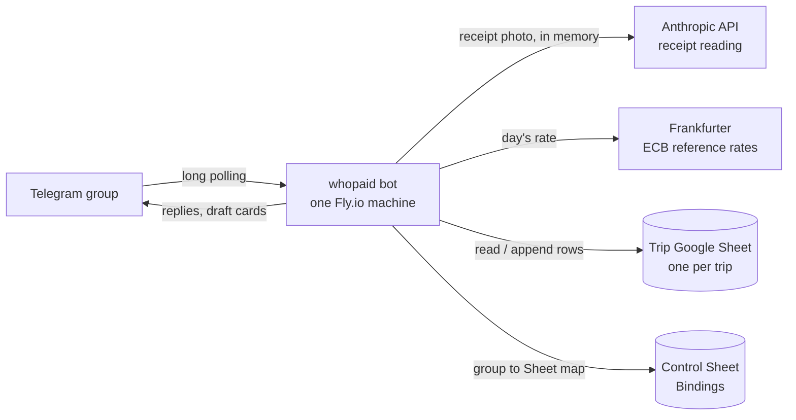

# whopaid

A Telegram bot that keeps a trip's group expenses in a shared Google Sheet. Type `1200 yen ramen`
or send a receipt photo; it converts to your home currency at that day's rate, splits it between
whoever was there (equally, by custom amounts, or item by item off the receipt), and tells you
who owes whom. One trip = one Telegram group = one Google Sheet. It runs on one small Fly.io
machine.

Project status and sign-offs: `STATUS.md`. Settled design decisions: `docs/spec/pinned-decisions.md`.

## Architecture



- **Bot** (`app/bot`): Telegram handlers, the draft cards and their buttons.
- **Services** (`app/services`): pure logic — the text parser, name resolution, splitting,
  settlement, receipt reading and total selection, exchange rates — plus the Google Sheets store.
- **Drafts** live in memory for 30 minutes while people press buttons; only a confirmed expense
  is written to the Sheet, in one atomic batch.

## Data model

Each trip Sheet has these tabs (headers use the trip's currency codes, e.g. `JPY Amount`):

| Tab | One row is | Key columns |
|---|---|---|
| Summary | formulas only | who owes whom, totals, by category / day / payer |
| Expenses | one confirmed or cancelled expense | payer, description, original amount, trip and home amounts, rate, split method, status |
| Splits | one person's share of one expense | share in trip and home currency |
| Line Items | one line from a receipt | amount, who had it, `claimed` / `everyone` / `proportional` for a By items split (`unassigned` otherwise), kind |
| Users | one trip user | Telegram user ID, name, joined |
| Exchange Rates | one cached rate | requested date, rate date, rate |
| Trip | the trip's settings | currencies, timezone |
| Read Me | plain-English guide to the tabs | |

Amounts are stored in major units (yen as whole numbers, SGD to 2 dp); the code works in minor
units. Every expense's shares add up exactly to its amount in both currencies. Expenses are never
deleted: `/undo` marks them `cancelled`. Hidden columns hold IDs; leave them, and don't edit rows
by hand.

## Splitting model

Every expense has one **payer** (who handed over the money) and one or more **participants**
(who owe a share). The draft card asks who should share it:

- **Just me** — the sender is the only participant.
- **Everyone** — every trip user who has run `/join`, counted at the moment you tap it.
- **Choose people** — one toggle per joined user (you start selected), then **Next**.

Below those, a **Paid by** row of names shows who paid (✓), you by default. If someone else
paid, tap their name.

With more than one participant the card asks how to split:

- **Equally** — everyone gets `total // n`; the leftover minor units (yen, cents) go one each
  to participants in Telegram user ID order, skipping the payer while anyone else is left.
- **Custom** — reply to the card with one line per person, e.g. `Amir 2000`. The card shows
  each person's amount and `Remaining: ¥0 ✅` once they add up exactly; **Confirm** only
  appears then. Anyone you don't mention gets nothing and is dropped.

The preview lists every share in both currencies, payer marked 💳, with **Confirm**, **Edit**
(back to choosing people, amount kept) and **Cancel**. Only the person who sent the expense can
press its buttons; anyone else gets "Only <name> can edit this".

You can skip the buttons in the message itself:

- `6000 yen dinner split everyone` (or `split all`)
- `6000 yen dinner split between me Amir and John` (also `among`, `with`)
- `3000 yen lunch paid by Amir` — the payer doesn't have to be a participant
- `3000 yen lunch @amir` — tagging someone means they paid (in a receipt caption too)

Names match a joined user's username, first name or full name, ignoring case; `me` is you. If a
name matches nobody or more than one person, the card asks "Who did you mean by 'Jon'?" with
buttons — it never guesses.

Shares are computed in the currency the expense was entered in, then converted to the other
currency share by share and reconciled with the largest-remainder method, so shares always add
up exactly to the expense amount in both currencies.

### Itemised receipts

On a receipt with 1 to 40 items, the split-method card offers **By items** next to Equally and
Custom. The item card has one button per item, `3 Gyoza ¥600 · AB`, with the initials of whoever
claimed it, and shows what is still unclaimed. Tax, service charge and discount lines are listed
in the text, never as buttons.

- **Anyone who has joined** taps the items they had; tapping again un-claims. A shared dish is
  tapped by each person who shared it and split equally between them. Tapping adds you to the
  expense if you weren't in it.
- **Rest → everyone** gives every unclaimed item to everyone in the expense. Tap one of those
  items to make it just yours again.
- **Done** (only the sender) works once nothing is unclaimed or after Rest → everyone. Until
  then it reads `Done (unclaimed: ¥x)` and tells you what is left.
- Reply to the item card with `mine 1,4`, `split 5 everyone` or `unclaim 2` instead of tapping.
- **The sender can tap for someone else**: pick their name in the "Tapping for" row under the
  items, and the sender's taps go to them until **Me** is picked again. Or reply `amir 1,3`.

Tax, service charge and discounts are spread in proportion to what each person's items cost
(largest-remainder method, so the yen add up exactly); someone with no items pays none of them.
The preview shows `items ¥a + tax ¥b − discount ¥c = ¥d` per person, and **Edit** returns to the
item card with the claims kept. The `Line Items` tab records who had each item and whether it
was `claimed`, went to `everyone`, or was spread `proportional`ly.

If the lines don't add up to the receipt total you picked, **Fix items** on that prompt opens the
item card with an extra **Unlisted** item for the difference (negative if the lines come to
more), to be claimed like any other. A total the bot picked on its own is at most 5 off the
lines; that small gap also becomes an Unlisted item. **Use total anyway** keeps the total but
turns By items off for that receipt.

## BotFather setup

1. In Telegram, open a chat with `@BotFather` and create a bot with `/newbot` (or pick yours with
   `/mybots`).
2. **API Token**: copy it into `TELEGRAM_BOT_TOKEN`. Treat it like a password.
3. **Bot Settings → Group Privacy → Turn off** (see Privacy mode below).
4. Optional: **Edit Bot → Edit Commands**, and paste:
   ```
   help - What this bot does
   join - Join this trip
   settrip - Bind this group to a Google Sheet
   recent - Last 5 expenses
   today - Today's expenses
   summary - Group totals
   mine - What I paid and owe
   balances - Everyone's balances
   settle - Who pays whom
   undo - Cancel my last expense
   ```

## Adding to a group

Use a dedicated group for the trip's expenses. Add the bot to it like any member, after turning
privacy mode off. Then bind the group to a Sheet (see "Binding a trip" below) and have everyone
send `/join`. When someone sends `/join`, the reply has an **I'm in too** button the others can
tap instead; **Everyone's in** removes the buttons.

## Privacy mode

The bot reads ordinary messages like `1200 ramen`, so Telegram's privacy mode must be **off**
(BotFather → Bot Settings → Group Privacy → Turn off). If the bot was already in the group when
you changed it, remove it and add it again, or it keeps the old setting. It only reacts to
messages with an amount of at most 12 words, commands, receipt photos, replies to its own cards,
and button presses; everything else is ignored.

Receipt photos are downloaded, resized, and sent to the Anthropic API entirely in memory —
they are never written to disk and never logged (not the image bytes, not the base64, not the
LLM request). Once the read finishes, the bot keeps only the Telegram file ID (so "Try again"
can re-download the same photo) and the structured facts it extracted: merchant, total, date,
and line items. Those facts, not the photo, are what end up in the Sheet.

## Google Cloud and Sheets

The bot writes to Google Sheets using a **service account**, not your personal Google login.

1. In the [Google Cloud Console](https://console.cloud.google.com/), create a project (or reuse
   one) and enable the **Google Sheets API**.
2. Create a service account under IAM & Admin → Service Accounts, then add a JSON key for it.
   Download the key file.
3. Put the whole contents of that JSON file, on one line, into `GOOGLE_SERVICE_ACCOUNT_JSON` in
   your `.env`. Not a file path — the JSON text itself. Keep the key file outside the repo, and
   print it as one line with
   `python3 -c "import json,sys;print(json.dumps(json.load(open(sys.argv[1]))))" path/to/key.json`;
   paste the output as the value, wrapped in single quotes.
4. Create one blank Google Sheet named `whopaid control` for the bot's own bookkeeping (it holds
   the map of Telegram group → trip Sheet). Share it with the service account's email (the
   `client_email` field in the JSON key, looks like `something@project.iam.gserviceaccount.com`)
   as **Editor**. Copy the Sheet's ID from its URL — the long string between `/d/` and `/edit` —
   into `WHOPAID_CONTROL_SHEET_ID` in your `.env`.

## Sharing with the service account

Each trip gets its own Google Sheet, created and owned by you.

1. Create a blank Google Sheet for the trip.
2. Share it with the service account's email (same one as above) as **Editor**. Without this,
   `/settrip` will tell you it can't open the Sheet.
3. Copy the Sheet's URL or ID — you'll paste it into `/settrip` in the next step.

### Binding a trip

In the Telegram group for the trip, run:

```
/settrip <Sheet URL or ID>
```

The bot checks it can open the Sheet, then asks three quick questions with buttons: the trip
currency (what you're paying in), the home currency (what you'll settle up in), and the
timezone (defaults to the one that matches the trip currency, e.g. Japan → Asia/Tokyo). Confirm,
and it lays out all the tabs and formulas in the Sheet. Running `/settrip` again in an already-
bound group asks before rebinding — it never wipes the old Sheet.

Once bound, everyone in the group should send `/join` (or `/start`) so the bot knows who's
splitting expenses.

## LLM setup

Receipt reading uses the Anthropic API (`ANTHROPIC_API_KEY`, see Environment variables). In the [Anthropic Console](https://console.anthropic.com/), set a monthly spend
limit on the API key so a bug or a flood of photos can't run up a surprise bill — a few dollars
is plenty for a trip's worth of receipts. Each receipt read costs a fraction of a cent to a
couple of cents; you can watch usage accrue under Usage in the Console.

### Receipts

Send a photo of a receipt in a bound group and the bot reads it with an LLM: merchant,
total, date, and the individual line items. Just photograph the whole receipt, including the
totals section at the bottom — the clearer and flatter the photo, the better the read.

If the receipt shows more than one number that could be the total (for example a
tax-included and a tax-excluded total both printed), the bot asks "Which is the final
total?" with buttons for each candidate, plus **Other amount** to type it yourself. If the
total you pick doesn't match the line items added up, it shows the difference with **Fix
items**, **Use total anyway** and **Cancel** — the total you chose is always what gets saved.

If the bot can't read a receipt at all (too blurry, not a receipt), it says "Couldn't read
that receipt" with two buttons: **Try again** (re-reads the same photo) and **Enter amount
manually** (reply to that message with just the amount, e.g. `2400`).

A caption on the photo overrides the description the LLM guessed — a receipt sent with the
caption `dinner` saves as "Dinner" rather than whatever the LLM extracted.

Line items are stored in the Sheet's `Line Items` tab. Item amounts there are always in the
trip currency; for a receipt paid in the home currency they are converted at that expense's
rate. A caption can also carry `split everyone`, `split between me Amir` or `paid by Amir`,
exactly as in a text expense.

## FX provider

Rates come from [Frankfurter](https://frankfurter.dev) (no key), which publishes the European
Central Bank's daily reference rates. Each expense uses the rate for its own date; on weekends
and holidays, or before the day's rate is out (around 16:00 CET), that is the previous business
day's rate, and the card shows which date it used. Rates are cached in the `Exchange Rates` tab.
If the provider can't be reached, the card says so with a **Retry** button and nothing is saved.
An expense can be in the trip currency or the home currency; anything else is refused.

## Environment variables

Set in `.env` locally (copy `.env.example`; never commit `.env`) and as Fly secrets in production.

| Variable | What |
|---|---|
| `TELEGRAM_BOT_TOKEN` | the bot's token from BotFather |
| `GOOGLE_SERVICE_ACCOUNT_JSON` | the service account's JSON key, the whole JSON on one line |
| `ANTHROPIC_API_KEY` | API key from console.anthropic.com |
| `WHOPAID_CONTROL_SHEET_ID` | ID of the control Sheet holding the Bindings tab |
| `LOG_LEVEL` | optional: `DEBUG`, `INFO` (default), `WARNING`, `ERROR` |

`BOT_VERSION` is baked into the image at deploy time (the short git SHA) and shown by `/help`.

## Local testing

```
uv sync
uv run pytest
uv run ruff check .
uvx pre-commit run --all-files
uv run python -m app
```

The tests need no network or keys: they use an in-memory Sheet, fixed exchange rates and a fake
receipt reader, and simulate several Telegram users pressing buttons. Run the bot locally only
while the deployed one is stopped (see Deployment). `docs/manual-test-checklist.md` is the full
manual regression run against a test group.

## Deployment

The bot runs on Fly.io as one machine, long-polling Telegram. **Stop the local bot before
deploying, and never run both at once** — two pollers on the same bot token make Telegram
return 409 and both go deaf.

1. Install flyctl (`brew install flyctl`, or see [fly.io/docs/flyctl/install](https://fly.io/docs/flyctl/install/))
   and run `fly auth login`.
2. `fly launch --no-deploy --copy-config --name whopaid-bot --region sin`. Answer **No** to
   Postgres, Redis and any other add-on.
   If Fly says the name is taken, accept the name it suggests (or use `whopaid-bot-<4 chars>`);
   `--copy-config` writes it into `fly.toml`, and every later command uses that name.
3. `./scripts/set-fly-secrets.sh` copies the secrets from `.env` to Fly. It prints the variable
   names it set, never the values.
4. `./scripts/deploy.sh`. Wait for "deployed successfully".
5. `fly status`. Exactly one machine, state `started`. If `fly machine list` shows two, run
   `fly scale count 1`.
6. `fly logs`. You see `whopaid started`.
7. Stop any local copy of the bot, then send `/help` and `500 coffee` in your test group and
   confirm it; the Sheet gets the row.

### Updating

Merging to `main` deploys automatically: `.github/workflows/deploy.yml` runs ruff and the
tests, then the same deploy as `./scripts/deploy.sh` (remote build, `--ha=false`). Watch it in
the repo's **Actions** tab; **Run workflow** there redeploys `main` by hand. Confirm `/help` in
the test group shows the new version. `./scripts/deploy.sh` from a laptop still works too.

The workflow needs one repo secret, `FLY_API_TOKEN`: a deploy token for this app only. Create
it in the Fly dashboard (the app → **Tokens** → create a deploy token, or `fly tokens create
deploy` on a laptop) and save it in GitHub under Settings → Secrets and variables → Actions →
New repository secret. If the token leaks, revoke it in the same Fly page and make a new one.

### Log level

`LOG_LEVEL` isn't set by `./scripts/set-fly-secrets.sh` (it isn't a secret). If you ever need
it, set it by hand: `fly secrets set LOG_LEVEL=DEBUG`.

### Why no port

The bot uses long polling: it calls out to Telegram, nothing listens for incoming connections.
There is no `[http_service]` in `fly.toml` and no Fly health check configured. The `whopaid
started` line in `fly logs` is the health signal — if it's there, the bot is up.

## Example usage

In the trip group (names here are examples):

```
Ada:     1200 yen ramen
bot:     🧾 Ramen
         ¥1,200 ≈ S$9.72
         Paid by Ada · 2 Oct 2026
         Rate 1 JPY = 0.00810 SGD (1 Oct)
         Who should share this?
         [Just me] [Everyone] [Choose people] [Cancel]
Ada:     (taps Everyone, then Equally)
bot:     Ramen — ¥1,200 (S$9.72)
         Paid by Ada
         Ada 💳 — ¥600 · S$4.86
         Amir — ¥600 · S$4.86
         [Confirm] [Edit] [Cancel]
Ada:     (taps Confirm)
bot:     Saved ✅ Ramen ¥1,200 (S$9.72)

Amir:    3000 yen taxi paid by Ada split between me and Ada
Amir:    /balances
bot:     Balances (SGD)
         Ada: paid S$34.02 · share S$17.01 · +S$17.01
         Amir: paid S$0.00 · share S$17.01 · −S$17.01
         Settle with /settle
Amir:    /settle
bot:     Amir → Ada S$17.01
```

Screenshots of these steps from a test group (no real names) belong in `docs/images/`.

## Settlement logic

Balances and settling up are in the home currency only, each expense converted at its own
day's rate (see `docs/adr/0001`). For each person: **paid** is the total of expenses they paid,
**share** the total of their shares, and **net** = paid − share (positive means they're owed).
Cancelled expenses don't count.

- `/balances` — paid, share and net for everyone with any activity, most owed first.
- `/mine` — your own three numbers and your last 3 expenses with your share of each.
- `/settle` — who pays whom, one line per transfer, e.g. `Amir → Ada S$31.20`, or
  "All square 🎉".

`/settle` is greedy: it repeatedly has the person who owes most pay the person owed most, as
much as one of them needs. That takes at most one transfer fewer than the number of people with a
balance. It is near-minimal, not guaranteed minimal.

## Limitations

- **Single machine only.** Exactly one bot process may poll Telegram; two (e.g. a laptop and Fly)
  make both stop receiving messages.
- **Drafts are lost on restart.** A card that was mid-way when the bot restarted says "This
  expense expired, please send it again".
- **Albums are separate drafts.** Several photos sent together each become their own expense.
- **Third currencies are refused.** Only the trip currency and the home currency can be recorded.
- **SGD figures depend on ECB reference rates**, published once per business day; they are not
  the rate your card or money changer used.
- **Summary formulas assume Google Sheets**, not Excel; exporting to Excel breaks them.
- Receipt reading can be wrong; check the total on the card before confirming.
- Names are matched against people who have sent `/join`; Telegram doesn't let bots see the
  member list.

## Stopping after the trip

1. In the group, run `/settle` and agree the transfers.
2. `fly scale count 0` stops the machine and the billing, keeping the app and its config. To use
   it for the next trip, `fly scale count 1`.
3. `fly apps destroy <app name from fly.toml>` removes the app entirely, if you're done for good.

The Sheets keep everything — expenses, balances and settlement live in Google Sheets, not on the
machine. Start each new trip with a new group and a new Sheet.
